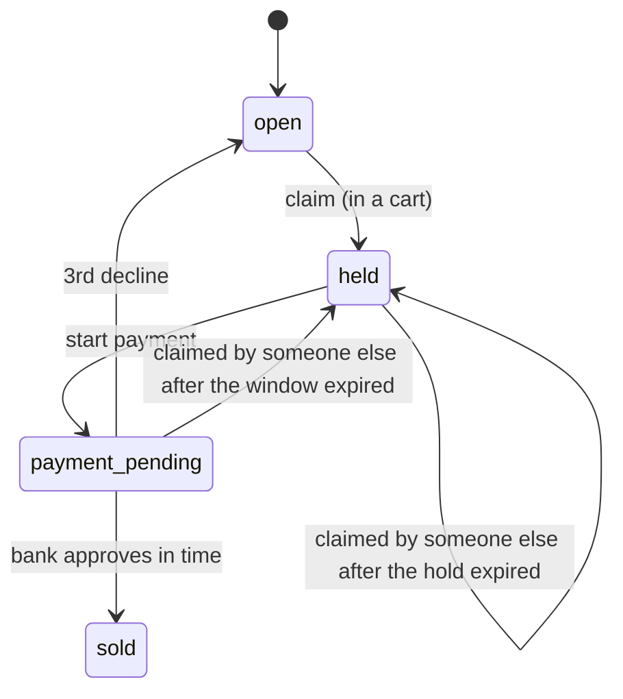

# Ticket Booking System

A ticket booking backend that never sells a seat twice, even when hundreds of people click at the same moment, and that makes life hard for scalper bots. There's a React front end with a waiting room, a seat map and checkout.

**What the tests show:**

- **100 buyers grab the same seat at the same instant: exactly 1 gets it.** The naive version (read the seat, then write it) sold one seat to 11 of 100 buyers.
- **300 fans buy 40 seats while 5 kinds of bots attack.** All 40 seats sell, each to one person with one captured payment, and no bot gets a seat. A verified scalper with 20 tabs is held to 3. The proof comes from the database rows after the run, not from the API's answers.
- **600 people waiting in line** with answers under 3 s (p95) on a ~7 GB laptop, using 4 API processes.

Stack: Python 3.12, FastAPI, PostgreSQL 16, Redis 7, React 18 + TypeScript (Vite), k6 for load tests. Payments, CAPTCHA and ID checks are mocked, but built so a real service plugs in.

## How a purchase works

1. **Account.** Sign up, then verify an ID (mocked). Each ID can verify only one account, so one real person = one account.
2. **Waiting room.** Solve a CAPTCHA (mocked) to join the line. Everyone who arrives before the sale opens gets a **random** place, so being a fast bot doesn't help. After that it's first come, first served.
3. **Your turn.** Up to 100 people pick seats at once. When a spot frees up, the next person gets a **signed token** that is good for 5 minutes. Every hold needs it, so calling the API directly doesn't skip the line.
4. **Pick up to 3 seats** and hold them together for 5 minutes. If someone grabbed one of them first, the rest stay held, and you pick a replacement or pay for the seats you have.
5. **Pay once for the whole cart.** You get a fresh 5-minute payment window and 3 attempts. The money is authorized first and captured only once the seats are marked sold.

## Selling a seat exactly once



- **Every change is one conditional `UPDATE`.** For example: "set this seat to `held` WHERE it is still `open` or its hold has expired". The database locks the row, so only one buyer's statement can match, and `rowcount == 1` means you won. There's never a separate "read, then write" step.
- **Expiry uses the database clock** (`now()`), so every server agrees on what "expired" means.
- **No cleanup job is needed for correctness.** An expired hold is simply claimable again. The claim checks the deadline itself.
- **A bank approval that arrives after the payment window is always voided**, even if nobody has taken the seat since. One simple rule, with no "is it still free?" edge cases.

### Carts: several seats, all or nothing

- A `carts` row holds the cart's deadline and payment attempts. Each seat points at its cart and keeps a **copy** of the deadline, so a claim still checks only the `seats` table. The copies always change in the same transaction as the cart.
- **Starting payment moves every seat on the buyer's screen to `payment_pending`, or none.** It's one `UPDATE`, and success means `rowcount` equals the number of seats the page sent. The count comes from the request on purpose. Say a seat expired and another buyer took it: it left the cart, so a count taken from the database would shrink to match and "succeed" with fewer seats than the buyer saw.
- If the page sends fewer seats than the cart holds (an out-of-date tab), the request is rejected and the buyer is told their cart changed.
- A replacement seat ends at the cart's existing deadline. A fresh 5 minutes per added seat would let someone swap seats forever to keep the others held.
- **Seats are always locked in id order.** Otherwise one request could hold seat 1 and wait for seat 2 while another holds seat 2 and waits for seat 1, a deadlock. Postgres may visit rows in the order they're stored on disk, so multi-seat statements lock through `ORDER BY id FOR UPDATE` first. A test moves a row on disk to prove it; that test failed before the fix.
- Each buyer's requests take turns (their account row is locked with `FOR UPDATE`), so a seat can't be added while Pay is starting, and 4 tabs can't all get past the 3-ticket limit at once. Without that lock, all 4 tabs won in 3 of 3 runs.

### Payments

- **Idempotency key per press of Pay.** A double-click or a network retry gets the original answer and never a second charge.
- **At most one pending payment per cart**, enforced by a unique index.
- **Payment states:** `pending → approved | declined | voided` and `approved → captured | voided`; declined, voided and captured are final. Each move is a conditional `UPDATE` from the expected state, so a late approval always loses.
- **The server waits for the bank** (mocked), and a timeout counts as no reply. A background job (`python -m app.jobs`) voids unanswered payments every 60 seconds.
- **The price always comes from the database.** The Pay request carries no amount.
- Money is stored as integer cents.

## Anti-bot layers

Cheapest first, so most bots are stopped before the expensive checks:

| Layer | Stops | Doesn't stop |
|---|---|---|
| CAPTCHA to join the line (single use) | Simple scripts | CAPTCHA-solving farms |
| Random places for early arrivals | Speed: bots arriving first | Numbers: 1,000 bots = 1,000 lottery tickets |
| Verified ID required to join | Fake accounts filling the line | One real person with many tabs |
| Signed, per-user queue token | Skipping the line through the API, forged or shared tokens | — |
| 3 tickets per person (held seats count too) | One person sitting on 40 seats | — |

There's deliberately **no per-IP limit**: scalpers rotate IPs through residential proxies, and shared IPs (dorms, offices) would block real fans.

The front end doesn't trust the buyer's clock either. Countdowns use a duration the server sends, counted with `performance.now()`, so changing the computer's clock can't stretch a hold.

## Tradeoffs

| Decision | Instead of | Why |
|---|---|---|
| One conditional `UPDATE` per seat change | Read, check, then write | The two-step version sold one seat to 11 of 100 buyers. |
| Claim the seat first, charge second | Charge, then assign a seat | Charging first means refunding every loser. |
| Authorize, then capture | Charge immediately | Releasing a hold is cleaner than a refund when the seat is lost. |
| Separate 5-minute payment window | Let the hold timer cover payment | A slow bank shouldn't let someone grab the seat mid-payment. |
| 3 payment attempts per cart | Retry until the timer ends | Stops one buyer sitting on seats with a bad card. |
| Wait for the bank's answer | Bank calls us back (webhook) | Simpler; webhooks bring duplicate and late callbacks. |
| Rolling admission (up to 100 choosing at once) | Batches of 100 | Batches leave the room half-empty while people wait. |
| 20-second heartbeat: silent people lose their spot | Keep spots until the 5-minute token expires | The load test found ~250 buyers who had given up still holding spots, and 18 seats went unsold. |
| Seats lost in a cart are reported; the rest stay held | All or nothing at hold time | Losing every seat because one was taken is frustrating. |
| One active cart per buyer | Several carts with their own timers | One countdown on screen; the ticket limit caps it anyway. |
| Random session token, stored hashed, `HttpOnly` cookie | A signed, stateless token | Logout and killing a stolen session work instantly. |
| Argon2 password hashes | A fast hash like SHA-256 | A stolen table must not reveal passwords. |
| 4 API processes | Making each request cheaper | One Python process uses about one core: it failed at even 300 waiting while 7 cores sat idle. All state lives in Postgres and Redis, so copies need no code changes. |

## Load test results

All runs are on one laptop (8 cores, ~7 GB RAM) that runs the API, Postgres, Redis and k6 together. Every buyer goes through the full flow: log in, CAPTCHA, wait in line, pick a seat (another if it's taken), pay.

| Test | Result |
|---|---|
| Correctness: 300 fans, 40 seats | 40/40 sold, each with exactly one captured payment; all 6 database checks pass |
| Bot attack: the same 300 fans plus line-skippers, token forgers, CAPTCHA reusers, queue hammerers and a 20-tab scalper | All 11 checks pass; fans 1.9x slower at the median (94 → 175 ms) and 1.7x at p95 (709 → 1222 ms), under the 2x limit |
| Capacity: people waiting in line, checking every 3 s | 600 waiting: p95 1.1 s; 1000: p95 3.3 s, over the 3 s limit, with the whole laptop's CPU at 100% |

- **Each database check is itself tested** by faking the exact cheat it should catch (`test_loadtest_checks.py`). A check that can never fail proves nothing.
- **The fans-only baseline is measured right before each attack run,** because the laptop's speed varies from day to day. The 2x median check gets noisy when the baseline is very fast (around 40 ms): 2 of 4 runs failed only that check, with every correctness check passing.
- **The load tests found 2 real bugs, both fixed:**
  - a connection-pool deadlock that froze the whole API for about 3 minutes;
  - abandoned queue spots (the heartbeat fix in the table above).

## Running it locally

You need Docker, Python 3.12+ and Node 18+. The load tests also need [k6](https://k6.io/).

```bash
cp .env.example .env              # then set QUEUE_SECRET to a long random string
docker compose up -d              # Postgres on port 5433, Redis on 6379

cd backend
python -m venv .venv
.venv/Scripts/pip install -e ".[dev]"     # macOS/Linux: .venv/bin/pip
.venv/Scripts/python -m app.seed          # creates a demo event and prints its URL
.venv/Scripts/python -m uvicorn app.main:app --host 127.0.0.1 --port 8000

cd ../frontend
npm install
npm run dev                       # http://localhost:5173/?event=<id printed by the seed>
```

The demo event's sale opens 1 minute after seeding. Vite forwards `/api` to the backend, so no CORS setup is needed.

**Tests.** Run `.venv/Scripts/python -m pytest` from `backend/` (134 tests). They **drop and recreate the tables and flush Redis**, which wipes your local data. Rerun the seed afterwards. Stop a multi-worker API first: its connection pools can use up Postgres' 200 connections, which the 100-buyer test needs.

**Load tests**, with the API running as `uvicorn app.main:app --host 127.0.0.1 --port 8000 --workers 4`:

```bash
.venv/Scripts/python -m app.loadtest bot-test 300     # fans only, then fans + bots: one PASS/FAIL verdict
.venv/Scripts/python -m app.loadtest capacity 5000    # how many people can wait in line
```

Use `127.0.0.1`, not `localhost`: on Windows, `localhost` tries IPv6 first and adds ~200 ms per connection.

## API

| Endpoint | What it does |
|---|---|
| `POST /accounts`, `POST /sessions`, `DELETE /sessions` | Sign up, log in (sets an `HttpOnly` session cookie), log out |
| `GET /me`, `POST /me/verify-id` | Who you are; the mock ID check |
| `GET /events/{id}` | Event and seat map (a hint: it goes stale; the hold decides) |
| `GET /captcha`, `POST /events/{id}/queue` | Get a puzzle; join the line or check your place (returns the queue token when it's your turn) |
| `POST /carts` | Hold up to 3 seats (`X-Queue-Token` header); reports seats someone else got |
| `POST /carts/{id}/seats` | Add a replacement seat; it ends at the cart's deadline |
| `POST /carts/{id}/pay` | Pay for the seats on screen (`Idempotency-Key` header); returns an outcome such as `sold`, `declined` or `cart_changed`, plus the seconds left |

## Project layout

```
backend/app/services/   carts.py (seat and cart state), checkout.py (the Pay flow), payments.py,
                        queue.py (Redis line, Lua admission, tokens), accounts.py, captcha.py, bank.py
backend/app/api/        routes.py
backend/app/jobs.py     voids payments the bank never answered
backend/app/loadtest.py load test setup and the database checks
backend/tests/          unit and concurrency tests
frontend/src/           Queue.tsx, EventPage.tsx, Checkout.tsx, Auth.tsx
loadtest/               k6 scripts: buyers.js, attack.js, capacity.js
```

## Known gaps

- **Two crash windows in payments:**
  - The job marks a payment voided before telling the bank. A crash in between leaves the money held until the bank's own authorization expires.
  - A crash between "seats sold" and "capture" leaves an approved payment on sold seats.

  Real systems fix both by reconciling against the bank's records.
- **Leftover queue tokens:** someone dropped from the room by the heartbeat keeps their token until it expires, so a script that stops checking in could still hold seats.
- **Refreshing during checkout loses the page's view of the cart.** The seats stay held until their deadline, but the page has no way to load the cart again. Until the deadline passes, the buyer also can't start a new cart.
- **Mocks:** the bank, CAPTCHA and ID check are mocked.
- **Out of scope:** refunds, seat sections and presales, adjacent-seat selection, and fraud scoring.
